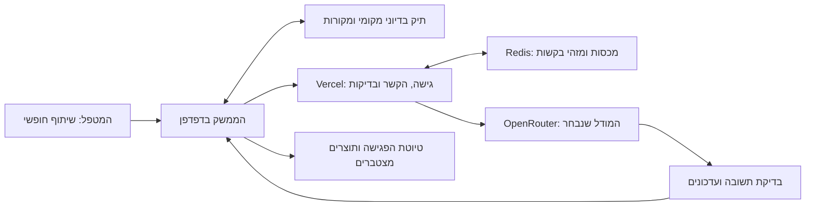

# פורטל קבלת פנים למטפל אחרי פגישה — תוכנית אב

> **מצב:** טיוטת תכנון לעיון, 16.10.2026. המסמך מגדיר מוצר והצעת מימוש; הוא אינו מעיד שהמוצר נבנה, נפרס או נבדק. הבנייה מתחילה לאחר סקירת התוכנית.
> **לסוכנים שיבצעו את התוכנית:** לעבוד במשימות תחומות לפי `superpowers:subagent-driven-development` או `superpowers:executing-plans`, לשמור על בעלות על קבצים ולהימנע מדריסת עבודת אחרים. סימוני המשימות במסמך הם לביצוע העתידי.

**מטרה:** ליצור דמו בעברית שמקבל שיתוף חופשי של מטפל אחרי פגישה, שואל מעט ובעדינות, ומפתח חמישה תוצרים לאורך רצף פגישות בדיוני.
**ארכיטקטורה מוצעת:** ממשק React ו־TypeScript באתר GitHub Pages; פניות חיות למודל דרך API ב־Vercel; מודלים באמצעות OpenRouter. התיק הבדיוני נשמר בדפדפן, ומכסות ההפעלה נשמרות בנפרד בצד השרת.
**טכנולוגיות מוצעות:** Vite, React, TypeScript, IndexedDB, Vercel Functions בסביבת Node.js, OpenRouter, ומאגר Redis משותף כגון Upstash למכסות ולמזהי בקשות.
**מפרט המקור:** החלטות אלעד בשיחה הנוכחית, רשימת 32 שדות האינטייק והמסמך שסיפק על רשומת פסיכולוג. המסמך שלהלן מרכז את המפרט המוצרי והטכני; אין להוסיף דרישות ממידע קליני שלא ניתן עבור שימוש זה.

## 1. מה סגור ומה עדיין מוצע

**דרישות שנקבעו:** מבוגרים בלבד; עברית ו־RTL; כניסה באמצעות בחירת מטופל ופגישה בלבד; כל חמש המטרות פעילות כברירת מחדל; שיתוף חופשי לפני שאלות; עד שלוש שאלות בזרימה הראשית; שאלה פתוחה אחת בכל הודעת תשאול; טיוטה גם כשחסר מידע; השלמת אינטייק רצונית אחרי הטיוטה; יעד אינטייק בפגישה החמישית; מסך ניהול הקשר; דמו עם פגישות קודמות; תצוגת ההוראות והאופן שבו המערכת פועלת; בחירת מודל, עם Sonnet 5.5 כברירת מחדל.

**ברירות מחדל טכניות מוצעות:** GitHub Pages לממשק, Vercel לשרת, Redis למכסות, IndexedDB לתיק הבדיוני, שני פרטי אינטייק בכל סבב השלמה, וקודי גישה להפעלה החיה. אלה בחירות מנומקות שניתן לשנות לפני המימוש.

**גבול הדמו:** כל המטופלים, הפגישות והדוגמאות יהיו מומצאים מתחילתם. אין צורך להשתמש במידע מטופלים אמיתי כדי לבנות או לבדוק את החוויה. הכנה להוראה והדרכה נכללת; שימוש למחקר, אימון מודלים או פרסום מאגר אינו חלק מהתוכנית.

**המצב הטכני לפי בדיקות השיחה:** GitHub CLI מחובר לחשבון `elad-refoua`; Vercel CLI בגרסה 50.35.0 מחובר לאותו שם משתמש. התוסף הרשמי `vercel/vercel-plugin` הותקן ברמת המשתמש דרך Codex marketplace. חיפוש תיעוד באמצעות Vercel MCP הצליח, וגם קריאת `list_teams` המאומתת הצליחה והחזירה רשימת צוותים ריקה. טרם נוצר או קושר פרויקט Vercel עבור הדמו וטרם בוצעה פריסה. מפתח OpenRouter טרם סופק ולא בוצעו פניות חיות בתשלום למודלים.

## 2. מה נדרש מוקדם כדי שהעבודה לא תיעצר באמצע

| רכיב | מצבו והפעולה הנדרשת | מתי נדרש |
|---|---|---|
| תוכנית המוצר | סקירת המסמך וקיבוע הבחירות לפני קוד מוצר | לפני הבנייה |
| GitHub | הגישה זמינה; ביצוע עתידי ייצור או יבחר מאגר ויגדיר Pages | לפני הפריסה הציבורית |
| Vercel | החשבון וה־CLI זמינים; יש ליצור ולקשר פרויקט API ולהגדיר סביבות | לפני הפעלה חיה |
| OpenRouter | לאלעד יש חשבון; אלעד ייצור מפתח מוגבל תקציב | לפני בדיקה חיה ראשונה |
| מפתח המודל | להזין כ־`OPENROUTER_API_KEY` בסודות האירוח; לא בצ׳אט, בקוד או במשתנה `VITE_` | לפני בדיקה חיה ראשונה |
| מאגר מכסות | ליצור Redis משותף ולחבר את השרת; לבדוק מראש את מסלול השירות ועלותו | לפני פתיחת הפעלה חיה |
| תוכן הדמו | להכין מקרים בדיוניים ורצף פגישות עם מקורות ותיקונים | לפני בדיקת החוויה |
| בדיקה חיה | לוודא את המודל, הספק, תמיכת המבנה והמחיר בזמן ההפעלה | לפני צריכת תקציב |

אפשר לבנות ולבדוק את המסלול המוכן ואת הממשק בלי מפתח ובלי קריאות בתשלום. לא נדרש מאלעד לבחור מחדש ספקים, צבעים או מספרי מכסות כדי להתחיל את ההכנה; ההמלצות במסמך משמשות בסיס לעיון.

## 3. החוויה שאליה מכוונים

המטפל מגיע עם זיכרון טרי ועם מעט אנרגיה לעוד משימה. הוא בוחר מטופל ופגישה, כותב את מה שהוא רוצה לשמר, והמערכת עוזרת להפוך זאת לתיעוד שימושי. היא אינה מציגה טופס ארוך, אינה מבקשת לבחור מטרות בכל כניסה ואינה דורשת להסביר את הטיפול מחדש.

הפשטות נמצאת במסך; המורכבות נמצאת בניהול ההקשר, בבחירת השאלה ובשמירת המקורות. איכות המוצר נמדדת במאמץ שנחסך ובדיוק התוצרים, לצד התחושה שהמטפל יכול לסיים בכל רגע.

העוזר אינו מדריך קליני. הוא מסייע להיזכר, להבהיר ולנסח את שיקולי המטפל. הוא אינו מציע אבחנה, פירוש או פעולה טיפולית משלו, ואינו הופך את השיחה למבחן מקצועי. גם בהמשגה, ההשערות הן של המטפל ומיוחסות אליו.

## 4. מסלול השימוש, צעד אחר צעד

1. **בחירת מטופל ופגישה.** שני פרטים בלבד. אפשר לחזור לפגישה קיימת או לפתוח פגישה חדשה במסגרת הדמו.
2. **הזמנה לשיתוף.** לדוגמה: ״מה חשוב לך לשמור מהפגישה?״ אפשר לכתוב קצר, ארוך, לא מסודר או בכמה הודעות.
3. **השלמת השיתוף.** פעולה ברורה כגון ״סיימתי לשתף״ מסמנת שאפשר לשאול. אין לקטוע כתיבה בשאלות או להפוך כל פסקה לתור תשאול חדש.
4. **אפס עד שלוש שאלות.** המערכת בוחרת רק פערים שכדאי לברר כעת. בכל הודעת תשאול מופיעה שאלה פתוחה אחת, על יחידת מידע אחת. אפשר לדלג, לומר שלא זוכרים או לסיים.
5. **טיוטה ללא תנאים.** ״סיים לטיוטה״ עובד גם בלי מענה על השאלות. שדות חסרים נשארים חסרים; אין השלמות משוערות.
6. **עיון ועריכה.** הרשומה מוצגת ראשונה. שאר התוצרים נגישים בלי להעמיס על המסך. המטפל יכול לערוך ולבדוק מקורות.
7. **השלמת אינטייק, אם רוצים.** לאחר הטיוטה מופיע כפתור ייעודי. ההמלצה היא עד שתי שאלות בכל סבב, אחת בכל הודעה; המשך דורש בחירה מפורשת.
8. **אישור ושמירה.** הטיוטה נשמרת אוטומטית מקומית; אישור יוצר גרסה מסומנת. שינוי מאוחר יוצר גרסה חדשה ולא מוחק את הקודמת.

הזמנה לפתיחה היא שאלת כניסה קבועה; תקרת שלוש השאלות מתייחסת לשאלות ההמשך אחרי השיתוף. אין להסוות שאלות נוספות כסעיפי הבהרה או כמשפטים ללא סימן שאלה. הודעת סיום יכולה להיות משפט חיווי בלבד.

אם כבר בשיתוף החופשי נאמר מספיק, אין חובה לשאול. אם המטפל ביקש לסיים, לא מופיעה ״רק עוד שאלה״. גם אחרי שגיאת מודל, אפשר לעבור לעריכה ידנית של טיוטה מסומנת המבוססת על החומר הקיים, בלי להציג אותה כתוצר AI חדש.

## 5. עדינות כתנאי התנהגות

- לשאול על מה שנאמר, בלי להכניס הסבר שהמטפל לא הציע.
- להימנע משאלות כן/לא, בחירה בין תשובות שמציע הבוט, שאלות כפולות ושאלות שמניחות תוצאה.
- לא לחייב ״למה״; לעיתים ״מה אתה זוכר...״ או ״איך היית מתאר...״ מכבידים פחות.
- להכיר בחוסר זיכרון בלי לנסות לחלץ תשובה באמצעות ניחוש.
- לא לשבח כל תשובה ולא לכתוב שיקופים ארוכים. אפשר להיות חם ומדויק גם במשפט קצר.
- לא להציג ציון למטפל, לא לנקד את איכות הפגישה ולא לשפוט את שיקוליו.
- להחזיק רצף פגישות בלי לפתוח בהסבר ארוך של מה שהמטפל כבר יודע.
- להשאיר את הקצב בידי המטפל. תשובה קצרה אינה סיבה להסיק על מצבו הרגשי.

**דוגמה בדיונית לשאלה ממוקדת:** ״אמרת שהשיחה השתנתה אחרי העצירה. מה השתנה בהמשך?״
**דוגמה שיש למנוע:** ״האם העצירה עזרה לו להרגיש מובן, ואיך זה קשור לדפוס שלו?״ — גם מובילה, גם כפולה וגם מציעה פירוש.
**תגובה לחוסר זיכרון:** ״בסדר, נשאיר את התגובה לא מפורטת.״
**תגובה לסיום:** ״נעבור לטיוטה עם מה שכבר כתבת.״

## 6. חמש המטרות וההפרדה בין התוצרים

| מטרה | מה מחלצים מתוך דברי המטפל | התוצר |
|---|---|---|
| רשומה שוטפת | נושאים מרכזיים, התערבויות שתוארו, תגובות, שינויים והמשך שסוכם | טיוטת רשומה לפגישה |
| המשגה | קשרים, דפוסים והשערות שהמטפל עצמו הציע, עם מידע תומך או סותר | המשגה מצטברת המבחינה בין תיאור להשערה |
| אינטייק | פרטי רקע והערכה שנמסרו לאורך הפגישות | 32 שדות מתעדכנים ודוח מסכם |
| זהב קליני | רגעים, ניסוחים והתערבויות שהמטפל מייחס להם ערך ללמידה | פריטים שניתן לחזור אליהם עם ההקשר והמקור |
| הדרכה | אי־ודאות, שאלות, תגובות אישיות ודילמות שהמטפל הביע | דף קצר לקראת הדרכה |

תשובה אחת יכולה לשרת כמה מטרות. אין צורך לשאול חמש שאלות שונות או לייצר חמש שיחות. ייתכן שלא יהיה חומר חדש להדרכה או לזהב קליני בפגישה מסוימת; אין להמציא חומר כדי למלא תוצר.

מחשבה שנמסרה להדרכה לא תיכנס אוטומטית לרשומה השוטפת. פריט למידה אישי אינו הופך לחומר הוראה מוכן לשיתוף. הכנה להוראה תהיה פעולה יזומה ונפרדת של המטפל, עם עיון מחודש בניסוח ובהקשר.

## 7. העדפות טבעיות תוך כדי שיחה

כל חמש המטרות פעילות בהתחלה. במקום מסך הגדרות בכניסה, המטפל יכול לכוון את העוזר בשפה רגילה. המערכת משקפת בקצרה מה הבינה, ומציגה העדפות פעילות באזור נגיש לעריכה.

| בקשה | משמעות תפעולית | ברירת מחדל בזמן |
|---|---|---|
| ״פחות על הרקע המשפחתי״ | מורידה את עדיפות השאלות בנושא; אינה מוחקת מידע קיים | הפגישה הנוכחית |
| ״אל תשאל על זה״ | חוסמת שאלות נוספות בנושא, גם במסלול ההשלמה | הפגישה הנוכחית |
| ״אל תכלול את זה בדוח״ | מונעת ניתוב הפרט לדוח שאליו מתייחסים; אינה שקולה למחיקת המקור | הפגישה הנוכחית |
| ״מהיום אל תשאל...״ | שומרת העדפה להמשך הטיפול הבדיוני, עם אפשרות ביטול | מתמשך, כי נאמר במפורש |
| ״סיימתי להיום״ | מפסיקה את התשאול ומציגה טיוטה | מיידי |

אם ״זה״ או ״הדוח״ אינם חד־משמעיים, אין לבחור בשקט יעד לא נכון. אפשר להציג לפרט את סימון הניתוב בממשק ולבקש הבהרה קצרה, או להחזיק אותו מחוץ לתוצר שטרם אושר. שאלת הבהרה עדיין נספרת בתקרת הזרימה הראשית.

העדפות על דוח חלות גם כשהדוח נוצר מחדש. אישור טיוטה אינו מבטל אותן. מחיקת מידע תהיה פעולה מפורשת ונפרדת; אין להסיק בקשת מחיקה מבקשת הקטנת מיקוד.

## 8. אינטייק עד הפגישה החמישית

היעד הוא להשלים את האינטייק עד הפגישה החמישית באמצעות חילוץ מן השיתוף החופשי ובירורים קצרים. לקראת הפגישה החמישית עולה עדיפותם של פערי אינטייק, אך תקרת השאלות וזכות הסיום אינן משתנות. יעד ההשלמה אינו הרשאה להשלים עובדות שלא נמסרו.

בסיום הפגישה החמישית מופק תמיד דוח בעל תשעה חלקים. **מבנה מלא אינו מידע מלא:** כשאין מידע, הדוח מציין את החסר במידת הצורך, ואינו מציג ״לא תועד״ כאילו מדובר בהעדר של תופעה. אין להציג אינטייק כמושלם רק מפני שהופק דוח.

מאחורי הדוח נשמרים כל 32 השדות בנפרד לעריכה. לכל שדה: תוכן, מצב מידע, מקורות, גרסה ומועד עדכון. המצבים יבחינו בין ״תועד״, ״תועד חלקית״, ״לא הוזכר״, ״לא נבדק״, ״לא זכור״, ״קיימת סתירה״ ו״לא רלוונטי״. מידע חלקי כולל סימון של מה שעדיין פתוח; אזכור יחיד אינו משלים בהכרח שדה רחב. ״לא נבדק״ ו״לא רלוונטי״ דורשים בסיס מפורש, ולא נוצרים אוטומטית משדה ריק. המערכת אינה מייצרת מכך שאלון משנה שחייבים להשלים.

אחרי הפגישה החמישית אפשר להציג הודעה שקטה כגון ״נשארו פרטים להשלמה באינטייק״. ההודעה אינה פותחת תשאול, מכבדת העדפות נושא, ומובילה למסך השדות או לסבב הרצוני.

| פגישה | התאמת סדר העדיפויות, בלי סדר שאלות קשיח |
|---|---|
| 1 | לקלוט תחילה את מה שנמסר ואת סיבת הפנייה; לא להפוך את המפגש הראשון לשאלון 32 שדות |
| 2 | לקשר מידע חדש לרקע שכבר נמסר; לשאול על פער רלוונטי כאשר הוא עולה באופן טבעי מתוך השיתוף |
| 3 | לסקור את הכיסוי המצטבר ולתת מעט יותר משקל לפערים משמעותיים שלא עלו |
| 4 | לבחור מתוך הפערים הנותרים את הבירור המועיל ביותר ולהבליט בעדינות את כפתור ההשלמה אחרי הטיוטה |
| 5 | להפיק אוטומטית את הדוח המסכם; לתת קדימות יחסית להשלמות רלוונטיות, תוך שמירה על תקרת השאלות וההעדפות |
| 6 ואילך | לשמר דוח זמין ומתעדכן, עם חוסרים גלויים ותזכורת לא חוסמת; אין לפתוח את האינטייק מחדש בכל פגישה |

אין הנחה שאפשר להשלים 32 שדות באמצעות 15 שאלות. רוב המידע אמור להגיע משיתוף חופשי, מפרטים שנמסרו קודם ומעריכה ישירה. השאלות משלימות מעט ובמכוון. אם המידע לא נמסר, ההשלמה העובדתית אינה מובטחת גם כשמבנה הדוח הושלם.

### 32 השדות — נוסח הרשימה שסיפק אלעד

1. פרטים מזהים ופרטי המפגש
2. פרטי הפסיכולוג והסטטוס המקצועי
3. הגורם המפנה
4. מקורות המידע
5. סיבת הפנייה
6. תלונת המטופל
7. תלונות ומידע מהורים, אפוטרופוסים או מלווים
8. הבעיה הנוכחית והתפתחותה
9. היסטוריה טיפולית ופסיכיאטרית
10. רקע רפואי ומחלות נלוות
11. טיפול תרופתי
12. אנמנזה התפתחותית
13. רקע משפחתי
14. מסגרת משפחתית ומערכות יחסים
15. רקע לימודי והשכלתי
16. רקע תעסוקתי
17. תפקוד חברתי ובין־אישי
18. תפקוד יומיומי והרגלים
19. אירועי חיים משמעותיים וגורמי דחק
20. התרשמות מהמפגש והתנהגות במהלכו
21. סטטוס נפשי וקוגניטיבי
22. הערכת אובדנות, מסוכנות ופגיעוּת
23. כוחות, משאבים וגורמי הגנה
24. אבחנה ראשונית או משוערת
25. אבחנות נוספות ומצבים המשפיעים על הטיפול
26. המשגה פסיכולוגית ושיקולים קליניים
27. מטרות הטיפול
28. תוכנית וגישה טיפולית
29. תגובת המטופל לתוכנית המוצעת
30. המלצות, הפניות והמשך מעקב
31. מסמכים ומידע נלווה
32. תאריך, שם מלא וחתימת הפסיכולוג

### מיפוי מוצע לתשעת חלקי הדוח

| חלק בדוח | מספרי שדות | הערה |
|---|---|---|
| פרטים כלליים ומקורות מידע | 1, 2, 3, 4, 31 | פרטי המפגש והמקורות; מידע מנהלי מוזן פעם אחת כשאפשר |
| סיבת הפנייה והבעיה הנוכחית | 5, 6, 7, 8 | לשמר מי מסר כל תלונה או תיאור |
| רקע ואנמנזה | 9, 10, 11, 12, 13, 14, 19 | להבחין בין רקע לבין מצב נוכחי |
| תפקוד נוכחי | 15, 16, 17, 18 | לשמר מועד והקשר של התיאור |
| התרשמות וסטטוס נפשי | 20, 21 | לנסח רק התרשמות שנמסרה בידי המטפל |
| הערכת סיכון | 22, 23 | כוחות ומשאבים נשמרים גם כמידע רחב, ולא מצטמצמים לסיכון |
| אבחנה והמשגה קלינית | 24, 25, 26 | לשמר הסתייגויות ומעמד של השערה |
| מטרות ותוכנית טיפול | 27, 28, 29 | לכלול רק מטרות ותכנון שנמסרו |
| המלצות וסיכום מקצועי | 30, 32 | שדה חתימה זמין; אין להציג חתימה אוטומטית של הבוט |

המיפוי הוא הצעת ארגון לדוח, לא קביעה רגולטורית. הנחיות הרשומה שסופקו הן חומר תכנון; תוקפן הרשמי והעדכני לא אומת במסגרת מסמך זה, ואין כאן טענה לעמידה בדרישות מקצועיות או משפטיות.

## 9. ניהול ההקשר: מה המערכת זוכרת ואיך

**תיק פגישה** מחזיק את השיתוף, שאלות העוזר, תשובות המטפל, תיקונים, העדפות מקומיות והטיוטות של אותה פגישה. **תיק מצטבר** מחזיק אינטייק, המשגה, חומר ללמידה ולהדרכה והעדפות מתמשכות, עם קישור למקורות.

היחידות הבסיסיות יהיו מטופל בדיוני, ענף הדגמה, פגישה, מקור ותוצר בגרסה. כל יחידה מקושרת למזהים יציבים. מספר פגישה או שם תצוגה אינם מספיקים לזיהוי. בקשת מודל מקבלת תמיד את המטופל, הענף והפגישה הפעילים.

**יומן מקורות:** דברי המטפל והעריכות שלו נשמרים כעדויות למה שנמסר. סיכומי AI והמשגות הם תוצרים נגזרים. אמירה שחזרה בכמה סיכומים אינה מקבלת מעמד עובדתי חזק יותר. ניסוח שנזכר בקירוב אינו הופך לציטוט ישיר.

**מניעת ערבוב:** מנגנון ההקשר בוחר מראש רק מקורות השייכים למטופל ולענף הנוכחיים. אין לשלוח למודל מאגר מעורב ולבקש ממנו להתעלם מן האחרים. כל עדכון מוחזר נבדק מול אותם מזהים.

**מניעת מידע מהעתיד:** נשמרים גם מועד הפגישה וגם מועד הוספת המידע. כאשר פותחים את פגישה 2, משתמשים בתמונת המצב שהייתה זמינה אז; סיכום שהוכן בפגישה 5 אינו מקור לפגישה 2. פרט שנמסר מאוחר על אירוע קודם אינו נחשב ידוע בזמן האירוע.

**תיקונים וסתירות:** תיקון מפורש יוצר גרסה מחליפה, עם המקור הקודם והסיבה לתיקון. הבדל בין שני דיווחים אינו תיקון אוטומטי: אם לא נאמר שהישן שגוי, שומרים סתירה או שינוי לאורך זמן. המטפל יכול לערוך שדה ישירות, בלי לנהל שיחה כדי לתקן טעות.

**אישור:** פגישה מאושרת יוצרת תמונת מצב שאינה נדרסת. תיקון מאוחר יוצר גרסה חדשה. זהו כלל התנהגות של הדמו, לא הבטחה לרשומה שאינה ניתנת לשינוי או לתוקף של חתימה רפואית.

**ענפי הדגמה:** פתיחת התנסות חלופית מפגישה קודמת יוצרת ענף חדש. הוא יורש רק את המקורות שהיו זמינים בנקודת הפיצול, ולא את הפגישות העתידיות בענף המקורי. השוואה בין ענפים אינה מחברת את הזיכרונות שלהם.

**תקציב הקשר:** לפני כל בקשה מרכיבים שכבות: הוראות; מצב השיחה; העדפות; תמונה מצטברת מותרת בזמן; מקורות רלוונטיים; השיתוף הנוכחי. קיצור נשען על כללים מוגדרים ואינו מסיר בשקט תיקונים, הסתייגויות או מקורות של טענות פעילות.

**החלפת מודל:** שינוי הבחירה חל בתור הבא ומשתמש באותה גרסת תיק. החלפה אינה מאפסת את ההעדפות ואינה יוצרת זיכרון נפרד. תשובה ישנה לא תישמר אם בינתיים השתנתה גרסת הפגישה או שהמשתמש עבר לענף אחר.

**תיקון שמשפיע על תוצרים:** תיקון מקור מסמן אילו טיוטות ותוצרים מצטברים הסתמכו עליו. תוצר מאושר נשאר בגרסתו המקורית; מוצעת גרסה מעודכנת עם סימון מה השתנה. בתוך הפגישה משתמשים גם בדברים החדשים שטרם אושרו כדי להבין את השיחה, אך הם מסומנים כמסירה נוכחית ולא כרשומה שכבר אושרה.

מסך ״הקשר המטופל״ יאפשר לעיין בציר הפגישות, באינטייק, בהמשגה ובחומר להדרכה וללמידה. לכל פרט יהיו מקור ומצב מידע. במסך הפגישה תוצג תמונה ״נכון לפגישה זו״, כדי שלא לבלבל בינה לבין המצב המצטבר העדכני.

## 10. מבנה הפרומפט והעבודה עם הידע הקיים על בוטים

הפרומפט ייבנה מתוך מסגרות simulation-architect ו־therapeutic-bot שנבדקו בתהליך ההכנה, תוך התאמה לתשאול מטפל אחרי פגישה. לוקחים מהן פירוט התנהגות, רגישות לקצב ודוגמאות של מצבי קצה; אין צורך להעתיק פרסונת מטופל או להפוך את העוזר למטפל של המטפל.

ההמלצה היא מודל דובר אחד עם רכיבי הוראות נפרדים. חמישה סוכנים עצמאיים אינם דרישת הדמו: הם עלולים להוסיף תיאום, זמן ועלות, ויש לבחון יתרון בפועל לפני הוספתם.

| רכיב | אחריות |
|---|---|
| ליבה | תפקיד העוזר, גבולותיו, עברית וסגנון קצר |
| מתשאל | שיתוף חופשי, שאלה פתוחה אחת, עדינות, דילוג וסיום |
| חמש מטרות | מה לחלץ ולאן לנתב; מתי לא ליצור תוצר חדש |
| ראיות ומקורות | הפרדת תיאור, פרשנות, חוסר מידע וסתירה |
| רצף פגישות | שימוש במידע המותר בזמן, תיקונים וגרסאות |
| העדפות | פחות מיקוד, חסימת שאלות והחרגה מדוח לפי היקף זמן |
| ניסוח טיוטות | מבנה התוצרים ושמירת הסתייגויות, בלי המצאת תוכן |
| דוגמאות | מצבים בדיוניים קצרים של התנהגות רצויה ושגיאות שיש למנוע |

הספירה של תורי תשאול והגבלת התקציב נאכפות בקוד. הקוד גם מסנן מזהי נושא שהמודל תייג מול העדפות החסימה. זיהוי נושא מתוך ניסוח טבעי אינו ודאי: שאלה על נושא מוסווה או כמה בקשות בתוך משפט אחד מחייבות בדיקות שיחה נוספות, ואינן נעשות בטוחות רק בזכות סכמה. פרומפט טוב אינו תחליף לכללים שהאפליקציה יכולה לאכוף בעצמה. תוכן הפגישה מסומן כמידע לשימוש, ולא כהוראות שיכולות לשנות את כללי המערכת.

כל הרצה שומרת גרסת פרומפט ורשימת ההקשר שנמסר בפועל. אפשר להראות את הטקסט המלא לצורך לימוד ובקרה, אך לא מפתחות, קודי גישה או סודות אחרים. מוצג הסבר החלטה קצר; אין חשיפה של חשיבה פנימית של המודל.

### כיצד נבחרת השאלה הבאה

לאחר השיתוף, המודל מחלץ פרטים עם מקורות ומציע את הפעולה הבאה במסגרת אותה קריאה. הוא מתחשב בחמש המטרות יחד. בחירת השאלה פועלת לפי סדר ברור:

1. בודקים אם המטפל סיים, אם מוצתה המכסה או אם נבחרה טיוטה. במצבים האלה לא שואלים.
2. מסירים שאלות על נושאים שנחסמו, שאלות שכבר נענו, ושאלות שהמטפל דילג עליהן או לא זכר.
3. נותנים קדימות לבירור שמשנה את הדיוק של רשומת הפגישה: למשל הבחנה בין תיאור לבין השערה, או פער ממשי בין מקורות.
4. משווים את התרומה של פערים אחרים מול המאמץ שיידרש לענות. שאלה המחוברת למה שהמטפל כבר מספר מקבלת עדיפות על מעבר חד לרשימת שדות.
5. מגדילים בהדרגה את משקל פערי האינטייק לפי מספר הפגישה, ומפחיתים משקל לנושאים שהמטפל ביקש לתת להם פחות מקום.
6. אם אין שאלה בעלת ערך ברור, מפיקים טיוטה. שדה ריק כשלעצמו אינו סיבה להמשיך.

אין כאן ניקוד קליני של המטופל. זהו מנגנון לתעדוף בירור ותיעוד. בשלב הראשון לא נציג למטפל ציונים ולא נשתמש בנוסחת משקלים שרירותית; נגדיר סדר עדיפויות ונבדוק אותו על מצבים בדיוניים.

### כיצד אכין את הפרומפט בפועל

אכין תחילה מסמך התנהגות עם דוגמאות חיוביות ושליליות, ואז ארכיב ממנו רכיבי הוראות בגרסאות. סוכן הסימולציות יסקור את העדינות והעקביות; בוחן נוסף יבדוק שיחות בלי לקבל מראש את התגובה הרצויה. בכל שינוי נשווה את אותו הקשר לפני השינוי ואחריו. דוגמאות הבדיקה מופיעות ב־[נספח בדיקות המתשאל](PROMPT_ACCEPTANCE_HE.md).

גרעין הוראות מוצע, שיפותח לפרומפט מלא:

> אתה עוזר למטפל לארגן זיכרון טרי מפגישה. התבסס על דבריו ועל מקורות התיק שנמסרו לך. החזק במקביל רשומה, המשגה, אינטייק, חומר ללמידה והכנה להדרכה. הקשב תחילה לשיתוף. אם נדרש בירור, שאל שאלה פתוחה אחת על דבר אחד, ורק במסגרת מכסת השאלות וההעדפות שקיבלת. ברר את ההבנה של המטפל; אל תציע פירוש קליני, אבחנה או דרך טיפול משלך. אל תהפוך שתיקה, חוסר זיכרון או אי־אזכור לעובדה קלינית. אם המטפל מבקש לסיים, או שהמידע מספיק לתוצר שימושי, עבור לטיוטה. שמור את ההבחנה בין מה שנמסר, השערה של המטפל ומה שעדיין לא ידוע.

זהו גרעין לעיון ולא הפרומפט הסופי. אליו יתווספו הגדרות המקורות והשדות, מצבי השיחה, כללי הפלט ודוגמאות שנבדקו. לא נייבא מסימולציות הוראות להמצאת עולם פנימי, רמזי גוף שלא נמסרו או ״אמיתות נסתרות״ על המטופל.

המערכת משתמשת בדרך כלל בקריאת מודל אחת לתור ובקריאה נפרדת ליצירת התוצרים. בדיקות הקוד אינן מצריכות קריאות מודל נוספות. השוואת מודלים או ניסוי הוראות הם פעולות יזומות, ולא תהליך שמתבצע בכל תשובה מאחורי הקלעים.

## 11. ״מאחורי הקלעים״ ובדיקת הוראות

האזור נפתח לפי רצון ואינו חלק הכרחי מתיעוד פגישה. ארבע לשוניות מוצעות:

1. **הוראות לעוזר:** הפרומפט בגרסתו הפעילה, עם הסבר קצר לכל רכיב והבחנה בין תבנית לבין ההוראות שנשלחו בפועל.
2. **מה העוזר יודע:** רשימת המקורות, ההעדפות, מועד החיתוך ותמונת המצב שנמסרו למודל; אפשר לראות גם מה הושאר בחוץ ולמה.
3. **מה קרה בתור הזה:** השאלה או הטיוטה, השדות שהוצע לעדכן, המקורות והסבר תמציתי לבחירה. מוצג אם העדכון אושר או נדחה.
4. **בדיקת הוראות:** שינוי הוראה אחת והרצת אותו מצב בדיוני להשוואה בין תגובות. השוואה חיה מסומנת וצורכת תקציב; תוצאות הניסוי אינן נכנסות לתיק.

״בדיקת הוראות״ היא המשמעות הפשוטה של מעבדת פרומפטים. בהיקף הראשוני אפשר להראות ניסויים מוכנים ולתת למנהל בלבד לערוך; עריכה פרטית מלאה וניהול הרשאות עשויים להיות שלב שני. קריאת הפרומפט המלא יכולה להיות ציבורית גם כשעריכתו מוגנת.

## 12. עיצוב הממשק

הכיוון הוא מסך עברי שקט, בעל עמודת עבודה אחת ורוחב קריאה נוח. בחירת מטופל ופגישה נמצאת בראש; השיחה במרכז; התוצרים נפתחים בהמשך. מידע על סוכנים, טוקנים ומבני JSON שייך למאחורי הקלעים.

כיוון העבודה נשען על מיומנויות `ui-ux-pro-max` ו־`frontend-design` שנקראו בתהליך ההכנה ועל בדיקת מערכת עיצוב. `Noto Sans Hebrew` הוא מועמד לגופן, לא החלטה שלא ניתן לשנות. צבעים וריווח ייבחרו לפי קריאות ותפקוד, ולא לפי מטאפורה רפואית כבדה.

- תמיכה מלאה ב־RTL, תוך שמירת כתובות, מזהי מודלים ומספרים בסדר קריא.
- מטרות לחיצה של לפחות 44 פיקסלים, ניגודיות שנמדדת בפועל, ניווט מקלדת ומיקוד גלוי.
- הבדלה חזותית בין מקור, טיוטה, שדה שערך המטפל והשערה המיוחסת אליו; צבע אינו אמצעי ההבחנה היחיד.
- ציר פגישות ברור, עם תאריך, מצב אישור וגרסה; מקור נפתח מן התוצר בלחיצה.
- מצבים מפורשים של שמירה, נשמר, בקשה פעילה, ביטול, שגיאה ותקציב שנגמר.
- בעת שגיאה הטקסט שהמטפל כתב נשמר; אין מסך ריק ואין התחלה מחדש.
- ביטול עוצר את ההמתנה בממשק; אין להבטיח שיבטל חיוב שכבר נוצר אצל ספק.
- בדיקה במסך מחשב ובמובייל, כולל מקלדת, גלילה ופתיחת תוצרים ארוכים.

לפני מימוש המסכים אכין מפת מצבים, תרשימי מסכים, שני כיווני עיצוב עם אותו טקסט עברי ומילון ניסוחים קצר. הכיוון המומלץ: רקע בהיר, כתב כהה, צבע פעולה ירקרק מאופק ועמודת קריאה ברוחב כ־720–780 פיקסלים. זהות המטופל והפגישה נשארת גלויה, ורצף הפגישות נפתח ברצועה צדדית. במובייל הוא הופך למסך עיון, ולא לשני לוחות צפופים.

Enter מוסיף שורה; Ctrl/Cmd+Enter וכפתור גלוי שולחים. תשובה חדשה אינה גונבת מוקד; מעבר למסך ההסברים אינו מאבד טקסט. תצוגת ״נשמר״ מופיעה רק אחרי שמירה מוצלחת. החלפת מטופל בזמן בקשה מונעת מהתשובה המאוחרת להיכנס לתיק החדש. נשמור תמיכה בקורא מסך ובהפחתת תנועה.

## 13. איפה נמצא כל חלק במערכת

| מקום | מה נמצא בו | מה אינו נמצא בו |
|---|---|---|
| מאגר GitHub | קוד הממשק והשרת, פרומפטים בגרסאות, תרחישים בדיוניים ותיעוד | מפתחות וקודי גישה |
| GitHub Pages | קבצי האתר הבנויים והמסלול המוכן הציבורי | קוד שרת פעיל או מפתח OpenRouter |
| הדפדפן / IndexedDB | מצב התיקים הבדיוניים, פגישות, ענפים, טיוטות ומקורות מקומיים | הבטחה לגיבוי או אחסון קליני מאובטח |
| Vercel Functions | אימות גישה, הרכבת בקשה, מגבלות, פנייה למודל ובדיקת תשובה | אתר סטטי המחזיק מפתח בדפדפן |
| סודות Vercel | `OPENROUTER_API_KEY`, סודות גישה ופרטי חיבור למאגר המכסות | פרסום בדפי הדמו או בפרומפט הציבורי |
| Redis משותף | מכסות, שריוני תקציב, נעילות ומזהי בקשות | תוכן הפגישות והפרומפטים עם תוכן המטפל |
| OpenRouter והספק הנבחר | הבקשה החיה הכוללת הקשר בדיוני נבחר והחזרת תשובה | זיכרון עצמאי שעליו האפליקציה מסתמכת בין פגישות |

GitHub Pages מארח אתר סטטי; משום כך פעולת המודל והסודות נמצאים בשרת נפרד. Vercel מחליף כאן את הצעת Cloudflare מהשלבים הקודמים. Render הוא חלופה אפשרית אם יתעורר צורך בשרת מתמשך, אך אין צורך להחזיק שתי תשתיות פעילות לדמו.

בגרסת הדמו השרת מקבל מהדפדפן חבילת הקשר בדיונית ובודק עקביות מזהים, ענף, פגישה וגרסאות. אחסון בדפדפן אינו אכיפת הרשאות קליניות בין משתמשים; מעבר למוצר אמיתי יחייב תכנון נפרד של אחסון והרשאות, ולא שינוי תווית בדמו.

שתי חלופות נשארות פתוחות לעיון: אירוח הממשק וה־API יחד ב־Vercel יפשט את החיבור ביניהם, כשהקוד עדיין ב־GitHub; חמישה סוכנים נפרדים יאפשרו התמחות נוספת אך יוסיפו קריאות ותיאום. ההמלצה לדמו היא GitHub Pages כפי שביקשת, Vercel ל־API, ומודל דובר אחד עם חמש אחריויות. נבחן שינוי רק אם בדיקות יראו ערך ברור.

## 14. הפעלה חיה, מודלים ותקציב

המסלול המוכן פתוח לצפייה ומסומן ״הדגמה מוכנה מראש״. מסלול חי מסומן ״התנסות חיה בחומר בדיוני״ ומצריך קוד גישה אישי מוגבל. אין להציג תשובה מוכנה כתגובה שהתקבלה עכשיו ממודל.

לפי בדיקת קטלוג OpenRouter במסגרת ההכנה ביום 16.10.2026, אפשרויות הבחירה הן `anthropic/claude-sonnet-5.5` כברירת מחדל, `openai/gpt-6.1-sol` ו־`google/gemini-3.8-flash`. אלו מזהי הקטלוג שנבדקו; יש לאמת מחדש זמינות, ספק, מחיר ותמיכה בפלט מובנה לפני הבדיקה החיה. יכולת רשומה בקטלוג אינה הוכחה שכל מסלול ספק יפעל באותה צורה.

| גבול מוצע | ערך |
|---|---|
| תקציב כולל לסבב הראשון | 10 דולר |
| תקרה יומית לכל הסביבה | 2 דולר |
| שריון מרבי לבקשה | עד 0.25 דולר, לפי גבולות קלט ופלט ומחיר מאומת |
| מספר הפעלות לקוד גישה | עד 20 ביום; כולל ניסויי הוראות והפקת טיוטה חיה |
| מקביליות | בקשה אחת לפגישה, ועד שתיים לכל הסביבה |
| חריגה או סיום תקציב | עצירה גלויה; אין החלפת מודל או טעינה כספית אוטומטית |

אלה תקרות להפעלה, לא תחזית עלות. האפליקציה מחשבת גבול עליון לבקשה לפני שליחתה ומשריינת אותו אטומית במאגר משותף. בקשה שגבולה העליון עולה על התקרה אינה נשלחת. עם מידע שימוש זמין מעדכנים את החיוב; מצב לא ברור אינו משחרר מיד את כל השריון.

יש להגדיר גם תקרת הוצאה בצד OpenRouter, בהתאם לאפשרות המאומתת בחשבון בזמן ההקמה. השרת אינו מאפשר למשתמש לבחור מזהה מודל שרירותי. קוד הגישה אינו נשמר בקוד הציבורי; אימותו מתבצע בשרת, עם הגבלת ניסיונות ואפשרות ביטול.

מכסות אינן נשמרות במשתנה בזיכרון של פונקציית Vercel: מופעים שונים צריכים לראות אותו חשבון תקציב. אם מאגר המכסות אינו זמין, הפעלה חיה נעצרת; המסלול המוכן נשאר זמין.

## 15. חוזה הבקשה ובדיקת הפלט

נקודות הקצה המוצעות הן `POST /api/turn` לתור שיחה ו־`POST /api/draft` להפקת טיוטה. הן מקבלות מבנה TypeScript משותף שנבדק גם בזמן ריצה: מזהה בקשה, מטופל, ענף, פגישה, גרסת מצב צפויה, מודל מאושר, גרסת פרומפט וחבילת הקשר עם מקורות.

`GET /api/models` יחזיר את שלוש האפשרויות המאושרות ואת יכולותיהן, אחרי סינון קטלוג הספק. גרסת מודל חדשה לא תחליף את ברירת המחדל באופן שקט. `POST /api/access` יחליף קוד גישה מאומת באישור שימוש קצר תוקף; השרת ישמור ערך מגובב של הקוד ומכסות, והאישור לא ייכלל בייצוא תיקים או במסך ההסברים. זהו מנגנון גישה לדמו, לא מערכת זהויות קלינית.

החיבור עצמו יבוצע מהשרת אל `https://openrouter.ai/api/v1/chat/completions`: המפתח יישלח בכותרת האימות, ובגוף הבקשה יהיו מזהה המודל, ההוראות, ההקשר, תקרת פלט וסכמת תשובה. נגדיר `response_format` לפי התמיכה המאומתת של המודל והספק, ונבדוק את התשובה שוב בעזרת סכמה בזמן ריצה, למשל Zod. לא נשלח אוטומטית אותו סט פרמטרים לכל מודל: קטלוג המודלים מציג תמיכה שונה, למשל בפרמטר temperature. מחרוזת פרומפט מהדפדפן לא תחליף את הוראות השרת; ניסוי הוראות יפעל במסלול מנהל נפרד ומוגבל.

הממשק וה־API נמצאים בשתי כתובות ולכן נגדיר הרשאות CORS רק לכתובות ההדגמה והפיתוח שנבחרו, לרבות טיפול בבקשות מקדימות של הדפדפן. CORS אינו תחליף לאימות הגישה. השרת יאכוף את המודל, גרסת הפרומפט, גודל הבקשה והמכסות; אלה אינם ערכים שהדפדפן רשאי להרחיב כרצונו.

תשובת תור כוללת: הודעה למטפל; סוג פעולה — שאלה, מעבר לטיוטה או סיום; עדכוני פגישה; עדכונים מצטברים; ייחוס מקורות לכל עדכון; והסבר החלטה קצר. תשובת טיוטה כוללת תוצרים נפרדים, מקורות והסתייגויות. לא מעדכנים את התיק מתוך טקסט חופשי שלא עבר בדיקה.

הבדיקה תחסום מזהי מקור שאינם קיימים בחבילה, ערבוב מטופלים או ענפים, שדות לא מוכרים, עדכונים החורגים מהעדפות, ותגובה לגרסת מצב שכבר השתנתה. הגבלת שאלות וסיום נאכפים בקוד. בדיקת JSON לבדה אינה מבטיחה שהשאלה אינה מובילה; לכך נדרשות גם בדיקות איכות שיחה.

עדכון נשמר פעם אחת בלבד לפי מזהה הבקשה. רענון או לחיצה כפולה אינם אמורים לייצר שתי פניות. כשל רשת אינו מפעיל ניסיון חוזר בתשלום ללא פעולה ברורה. אין מעבר שקט למודל אחר ואין הכנסת עדכון חלקי לתיק.

לפני אישור הפלט אפשר להציג מצב ״מכין תשובה״. אין להציג למטפל טקסט גולמי בזרימה ואז לגלות שלא עבר בדיקה. יומני התפעול ישמרו מזהים, זמן, מודל, שימוש וסוג תקלה; לא יכילו מפתחות או תוכן פגישות כברירת מחדל.

טקסט המודל יפורש כתוכן להצגה, לא כ־HTML או קוד להרצה. נעצב ידנית את השדות שעברו בדיקה. בקשה שנכשלה אחרי שנשלחה לספק תקבל מצב מפורש של תוצאה לא ודאית; מזהה הבקשה והשריון יישמרו כדי שלא לחייב שוב אוטומטית.

## 16. תוכן הדמו ובדיקות שממחישות ערך

יוכנו מספר תרחישים בדיוניים למבוגרים, עם רצף עד פגישה 5 ופגישה נוספת המדגימה המשכיות. לכל תרחיש יהיו מקורות מוגדרים; אין לבנות דוגמאות מתוך תיק קליני אמיתי או ״לטשטש״ תיק כזה.

תרחישי חובה: אינטייק שמתמלא משיתוף חופשי; אינטייק שנותר בו חוסר בפגישה 5; שינוי או סתירה לאורך זמן; תיקון פרט קודם; בקשה להפסיק נושא; החרגה מדוח; חוסר זיכרון; סיום בלי שאלות; הפרדת הדרכה מרשומה; פיצול ענף; ובקשה שנכשלת בלי לאבד כתיבה.

בהשוואת מודלים משתמשים באותו מצב בדיוני, באותה גרסת פרומפט ובאותם מקורות. בודקים עדינות, שאלה אחת, העדר הכוונה, דיוק המקורות וכיבוד הסיום. אין לבחור מנצח לפי רושם משיחה אחת או להבטיח איכות מושלמת.

[נספח בדיקות הפרומפט](C:/Users/user/Desktop/projects/ISER-oct-26/Planning_2026-10-16/PROMPT_ACCEPTANCE_HE.md) מפרט מצבי קבלה קונקרטיים, ובהם חוסר זיכרון, סיום מיידי, איסור שאלות בנושא, סתירות ברקע ומידע חסר בפגישה החמישית.

## 17. חלוקת קבצים מוצעת לביצוע

כל הנתיבים להלן הם הצעות לקבצים שייוצרו בבנייה, ולא תיאור של קבצים שכבר קיימים:

- `apps/web/src/features/session/` — כניסה לפגישה, שיתוף, תשאול וטיוטה.
- `apps/web/src/features/patient-context/` — ציר פגישות, אינטייק, מקורות, העדפות וגרסאות.
- `apps/web/src/features/backstage/` — ארבע לשוניות ההסבר והניסוי.
- `apps/web/src/storage/` — IndexedDB, ייצוא, ייבוא ואיפוס של מצב בדיוני.
- `apps/api/api/turn.ts` ו־`apps/api/api/draft.ts` — נקודות הקצה ב־Vercel.
- `apps/api/src/access/` ו־`apps/api/src/budget/` — גישה, שריונים, מכסות ומניעת בקשות כפולות.
- `apps/api/src/model/` — קריאת OpenRouter ובדיקת פלט; `apps/api/src/context/` — הרכבת ההקשר המותר.
- `packages/contracts/` — טיפוסים וסכמות משותפים; `packages/prompts/` — רכיבי הוראות בגרסאות.
- `fixtures/fictional/` — תרחישים ומקורות בדיוניים; `tests/` — בדיקות לוגיקה, API ושימוש בדפדפן.
- `QA_YYYY-MM-DD/` ו־`Release_YYYY-MM-DD/` — תיקיות תוצרים מתוארכות שייווצרו ביום הבדיקה והמסירה בפועל.

## 18. שלבי הביצוע ותנאי סיום

| שלב | מה עושים ואיך | תוצר ותנאי מעבר |
|---|---|---|
| 1. קיבוע המפרט | עוברים על דרישות השיחה מול המסמך ומקבעים מבני מידע, מצבי שיחה ומדיניות העדפות | מפרט שניתן לעקוב ממנו לכל מסך ולכל בדיקה |
| 2. פרומפט ותרחישים | כותבים רכיבי הוראות ודוגמאות בדיוניות; בודקים שאלות מובילות, כפל שאלות ומקורות | פרומפט בגרסה ראשונה ומצבי בדיקה בעלי תשובות צפויות מבחינת התנהגות |
| 3. מסלול מוכן | בונים ממשק RTL ורצף מקומי ללא מודל; מוסיפים שמירה, מקורות, טיוטות ומאחורי הקלעים | שימוש מלא בדפדפן, כולל סיום מוקדם ושחזור אחרי רענון |
| 4. הקשר מצטבר | מממשים בידוד מטופלים, חיתוך בזמן, גרסאות, 32 שדות, תיקונים וענפים | פגישה מוקדמת אינה רואה עתיד; תיקון אינו מוחק היסטוריה |
| 5. API מוגן | מקימים גישה, סודות, רשימת מודלים, Redis ומכסות; בודקים בתחילה מול תשובות מלאכותיות | בקשה לא מורשית או חורגת נעצרת לפני פנייה למודל |
| 6. חיבור חי מוגבל | מוסיפים מפתח בסביבה, מאמתים ספק ומבנה, מריצים מספר קטן של תרחישים בדיוניים בתקציב | פלט נבדק לפני הצגה ושמירה; כשל אינו גורם לחיוב חוזר אוטומטי |
| 7. עיון במוצר | בודקים כמטפל בדפדפן, במובייל ובמקלדת; סוקרים תגובות והפרדת תוצרים | תיעוד של מה נבדק ושל מגבלות שנמצאו, עם תיקון כשלים מהותיים |
| 8. פריסה ומסירה | מפרסמים Pages ו־API, מחברים כתובות ומבצעים שוב את מסלולי המשתמש מהכתובות האמיתיות | קישורים עובדים, הוראות גישה ואיפוס, תקציב פעיל וגרסת מסירה מתועדת |

- [ ] לפני בדיקות חיות: אין מפתח במאגר או בקובצי האתר; תקרות ההוצאה מוגדרות.
- [ ] לפני מסירה: הזרימה הראשית אינה עוברת שלוש שאלות; מסלול ההשלמה אינו נפתח בלי בחירה.
- [ ] לפני מסירה: כל 32 השדות קיימים לעריכה וכל תשעת חלקי הדוח קיימים בפגישה 5, גם כשחסר מידע.
- [ ] לפני מסירה: שינוי העדפה, מודל, מטופל או ענף אינו גורם לשמירת תגובה ישנה במקום שגוי.
- [ ] לפני מסירה: בדיקת מקביליות מאשרת שמכסות אינן נעקפות באמצעות בקשות בו־זמניות.
- [ ] לפני מסירה: שימוש בדפדפן מאשר את הממשק, השמירה, השגיאות, המקורות והקישורים; בדיקת API לבדה אינה מספיקה.

בדיקות התוכנה יתמקדו בסיכונים מהותיים: בידוד הקשר, זמן ידע, גרסאות, ניתוב, תקציב ובקשות כפולות. איכות העברית והעדינות דורשת גם סקירה אנושית של שיחות; אין בדיקה אוטומטית שמוכיחה לבדה חוויה נעימה.

**כיצד אפרוס:** לאחר שהמסלול המקומי עובד, אצור מאגר ייעודי ב־GitHub עם קוד ותוכן בדיוני בלבד. תהליך GitHub Actions יבנה את הממשק ויפרסם את תיקיית התוצר ל־Pages. אגדיר את נתיב הבסיס של האתר בהתאם לכתובת המאגר, ואבדוק גם פתיחת קישור ישיר ורענון. ב־Vercel אגדיר פרויקט נפרד ל־API, עם תיקיית שורש מתאימה למבנה המאגר, סודות וסביבות Preview ו־Production. כתובת ה־API תהיה הגדרה ציבורית בממשק; מפתח המודל יישאר בסביבת השרת בלבד. אבדוק את שתי הכתובות יחד בדפדפן, כולל אימות, בקשה חיה, שגיאה, שמירה ומעבר פגישה.

**כיצד תלווה הבנייה בהסבר:** עם כל שלב אעדכן מה נוסף, באיזה קובץ או שירות הוא נמצא, כיצד הוא מתחבר למסך, ומה נבדק בפועל. במאגר יהיו README להפעלה, מסמך ארכיטקטורה, מפרט הפרומפטים ורשימת בדיקות. בממשק יהיה הסבר קצר ידידותי, ובמאחורי הקלעים אפשרות להעמיק. לא תצטרך לקרוא קוד כדי להבין מה כבר עובד ומה עדיין מתוכנן.

## 19. הרחבות שאינן תנאי לדמו הראשון

עריכת פרומפטים פרטית עם הרשאות מפורטות, הכתבה קולית של המטפל, שיתוף מאובטח בין מכשירים, ייצוא מסמכים מעוצבים והשוואת מודלים בהיקף רחב יכולים להתווסף לאחר בדיקת הזרימה המרכזית. הקלטת פגישת הטיפול אינה חלק מהחזון הנוכחי.

איפוס וייצוא של המידע הבדיוני כלולים כבר בגרסה הראשונה. הממשק יסביר שהשמירה מקומית לדפדפן ואינה גיבוי. ייבוא יבדוק מבנה וגרסה, ולא יוסיף נתונים לא מזוהים לתיק קיים.

בגרסה הראשונה אפשר יהיה להעתיק תוצר ערוך ולייצא טקסט או Markdown, לצד JSON של מצב ההדגמה לצורך שחזור. הכנת DOCX או PDF מעוצב היא הרחבה נפרדת; אין צורך לעכב בגללה את בדיקת התשאול וניהול ההקשר.

## 20. מקורות טכניים לבדיקה בזמן המימוש

- [GitHub Pages — אופי האירוח הסטטי](https://docs.github.com/en/pages/getting-started-with-github-pages/what-is-github-pages) — הבסיס להפרדה בין האתר לבין ה־API.
- [Vercel Functions](https://vercel.com/docs/functions) — סביבת הריצה, מגבלות והגדרות לפונקציות השרת.
- [Vercel Environment Variables](https://vercel.com/docs/environment-variables) — הגדרת סודות לפי סביבת פריסה.
- [Vercel for GitHub](https://vercel.com/docs/git/vercel-for-github) — חיבור מאגר ותהליך פריסה.
- [Vercel Get Started](https://vercel.com/get-started.md) — מקור תהליך ההקמה שביקש אלעד במפורש.
- [Upstash Redis — תיעוד](https://upstash.com/docs/redis/overall/getstarted) ו־[Redis Transactions](https://redis.io/docs/latest/develop/interact/transactions/) — בסיס למכסות משותפות ולעדכונים אטומיים; יש לבחור מנגנון התואם לשירות בפועל.
- [OpenRouter Models API](https://openrouter.ai/api/v1/models) — אימות מזהים ויכולות במועד החיבור.
- [OpenRouter Chat API](https://openrouter.ai/docs/api/api-reference/chat/send-chat-completion-request) ו־[Structured Outputs](https://openrouter.ai/docs/guides/features/structured-outputs) — מבנה הפנייה ופלט מובנה; יש לאמת תמיכה במסלול הספק הנבחר.
- [OpenRouter Limits](https://openrouter.ai/docs/api/reference/limits) — בדיקת מגבלות החשבון והמפתח בזמן ההקמה.

המסמך אינו מבטיח תאימות רגולטורית, אבטחה קלינית או איכות מושלמת של מודל. הוא מגדיר דמו בדיוני, בדיקות קונקרטיות וגבולות ברורים, כדי שאפשר יהיה להעריך את הערך לפני מעבר למוצר קליני.
